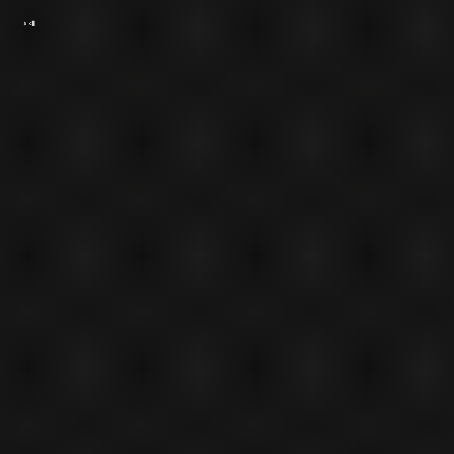

# OrcaCode Review

**[AI code review](https://www.orcarouter.ai/code-review) that catches serious issues before they merge — powered by ****[OrcaRouter](https://www.orcarouter.ai/)****.**

Automatically review every pull request, post findings directly on the affected lines, and block serious issues from merging.

**P0/P1 → ❌ Block** · **Findings → 💬 Comment** · **Clean → ✅ Pass**

---

<p align="center">
  
</p>

---

## How it works

```text
PR → Review → Merge Gate
        │
     P0/P1?
        ↓
      BLOCK
```

Every push gets one review. Findings post on the affected lines, and P0/P1 blocks the merge.

**You choose the model in OrcaRouter. OrcaCode handles the review.**

### What you get

* 🔍 Automatic review on every PR
* 💬 Inline findings on the affected lines
* 🛑 Merge gate for serious issues
* 🧠 Choose your own review model
* 🎯 Precision filtering to reduce false positives
* 🔒 OrcaRouter guardrails + security policies
* 🔄 Re-run anytime with `/orcacode-review`

---

## Install

One command teaches your AI what OrcaCode Review is. Everything after that, you just ask for.

```bash
npx @orcarouter/code-review
```

It asks how you will use it — local review, the GitHub Action, or both — detects which coding agents you use, installs the matching skills, and stops. Then:

> **you:** set up OrcaCode Review in this repo

Your agent writes the workflow, walks you through the API key, and sets the merge gate — asking only the questions that are actually yours to answer.

<p align="center">
  
</p>

The same goes for everything else:

| Say | It does |
| --- | --- |
| *"review my changes"* | Reviews them **locally**, itself — see [below](#review-locally-your-agent-is-the-engine) |
| *"why didn't the review run?"* | Diagnoses the secret, the trigger, the base branch, the gate |
| *"make OrcaCode Review block P0 only"* | Retunes the merge policy |
| *"remove OrcaCode Review from this repo"* | Drops the required check first, then the workflow |
| *"what can OrcaCode Review do?"* | Explains itself |

**Claude Code** can install the skill as a plugin instead, which keeps it updated:

```text
/plugin marketplace add Continuum-AI-Corp/orca-code-review
/plugin install orca-code-review
```

### 36 agent platforms

The same catalog the [OrcaDub MCP server](https://github.com/Continuum-AI-Corp/orcadub-mcp-server) uses, so IDs and paths match across Orca products. Detected agents are pre-ticked; `/` filters the list. For CI or dotfiles, the same choices are flags (`--mode`, `--scope`, `--platform`, `--yes`) — `--help` lists them.

Prefer to wire it by hand? The manual steps are below.

Claude Code, Cursor, Codex, OpenCode, Windsurf, Cline, RooCode, Continue, GitHub Copilot, Gemini CLI, Amazon Q Developer, Qwen Code, Kilo Code, Auggie, Kimi Code, Kiro, Lingma, Junie, CodeBuddy Code, CoStrict, Crush, Factory Droid, iFlow, Pi, Qoder, Antigravity, Antigravity 2.0, Bob Shell, ForgeCode, Trae, Trae CN, ZCode, MimoCode, Hermes, OpenClaw, Command Code.

Two skills: `orca-review` for reviewing locally and `orca-review-action` for the GitHub Action. The installer asks which you want, or both. An existing identical skill is left unchanged; an existing **different** one is preserved unless you pass `--force`.

### Language

The CLI speaks **English, Simplified Chinese, Japanese and Korean**, picked from your locale (`LC_ALL` / `LC_MESSAGES` / `LANG`). The guided flow opens with a language screen; `ORCACODE_LANG=zh` pins it for good.

Traditional Chinese locales (`zh-TW`, `zh-HK`) fall back to English on purpose — the vocabulary diverges enough that serving Simplified reads worse than not translating at all.

Menus are arrow-key driven — `↑↓` to move, `Enter` to pick. Multi-select adds `space` to toggle, `a`/`n` for all/none, and `/` to filter (`ctrl-u` clears it), which is how you find one agent among 36 without scrolling. Terminals without raw mode fall back to typing a number.

Only prose is translated — flags, platform IDs, workflow inputs, and shell commands stay verbatim, because you still have to type them.

---

## Review locally — your agent is the engine

The Action pays a model in CI to review every PR. You can also run the **same review, right now, in your terminal**, with no Action, no OrcaRouter account, and no API key — because the model is the one your coding agent already has.

> **you:** review my changes

<p align="center">
  
</p>

Claude Code, Codex, Cursor, or any of the 36 platforms picks up the `orca-review` skill and becomes the reviewer. You say what to review; the skill handles the rest:

| Say | It reviews |
| --- | --- |
| *"review my changes"* | Uncommitted work if the tree is dirty, otherwise this branch against its base |
| *"review this branch"*, *"review that commit"* | The range you named |
| *"review PR 556"* | That pull request — **without checking it out**. It is fetched into a private ref; your work tree stays exactly where it was. Fork PRs included |
| *"is this safe to merge?"* | Same, and the gate answers |

Behind the skill are two CLI commands your agent runs for you: `review plan` decides what is in scope — with the reasons for what is not — and hands the agent the per-language checklists, the P0–P3 rubric, and your repo's own `AGENTS.md`/`CLAUDE.md` conventions; `review submit` verifies every finding is filed on the right line, drops duplicates, applies the merge gate, and prints the report your agent relays to you. Nothing that decides what blocks is left to the model.

**It is the same severity contract the Action enforces** — the same `rules/severity-instruction.md`, the same position check, the same result shape. A P1 you find here is a P1 that would block there. That parity is the point: *"it passed locally"* has to mean something.

The file selection is the engine's, without the engine: the exclusion rules and per-language checklists from [Open Code Review](https://github.com/alibaba/open-code-review) (Apache-2.0) ship inside this package, so a local review filters the same files CI would. Nothing extra to install.

Settings that should stick live in a committed `.orcacode-review.json` — which severities block, which language to report in, paths never to review, extra checklists for parts of the tree. You do not write it by hand: after your first review in a repo the agent offers to save the settings it just used, and later *"from now on only block on P0 locally"* or *"never review docs/"* edits the right key.

Scripting your own harness instead of using an agent? `review plan --json` and `review submit --json` are a stable, versioned contract; [`skills/orca-review/references/contract.md`](skills/orca-review/references/contract.md) is the reference.

---

## Quick Start

### 1. Enable OrcaCode Review

Go to [**OrcaRouter**](https://www.orcarouter.ai/) → **Apps → OrcaCode Review** and turn it on.

Configure your models, review mode, severity rules, merge policy, and other settings directly from the console.

### 2. Install the GitHub Action

[**Install OrcaCode Review from GitHub Marketplace →**](https://github.com/marketplace/actions/orca-code-review)

Add this workflow as `.github/workflows/orca-code-review.yml` (or let `npx @orcarouter/code-review` write it). Use the whole file, not just the `uses:` step: the job's `if:` is what keeps the paid `/orcacode-review` command to maintainers, and the concurrency block is what stops any commenter from cancelling a running review. The action also refuses an outsider's command on its own, but the workflow is the first gate.

```yaml
name: OrcaCode Review

on:
  pull_request_target:
    types: [opened, synchronize, reopened, ready_for_review, edited]
  issue_comment:
    types: [created]

permissions:
  contents: read
  pull-requests: write
  issues: write
  statuses: write # the verdict on the PR head — the check to make required

jobs:
  review:
    runs-on: ubuntu-latest
    concurrency:
      group: ${{ github.workflow }}-${{ github.event_name == 'issue_comment' && 'comment' || 'pr' }}-${{ github.event.pull_request.number || github.event.issue.number }}
      cancel-in-progress: ${{ github.event_name != 'issue_comment' }}
    if: |
      (github.event_name == 'pull_request_target' &&
        (github.event.action != 'edited' || github.event.changes.base)) ||
      (github.event_name == 'issue_comment' &&
        github.event.issue.pull_request &&
        (startsWith(github.event.comment.body, '/orcacode-review') ||
          startsWith(github.event.comment.body, '/orcacode review') ||
          startsWith(github.event.comment.body, '@orcacode-review') ||
          startsWith(github.event.comment.body, '@orcacode review')) &&
        contains(fromJSON('["OWNER", "MEMBER", "COLLABORATOR"]'), github.event.comment.author_association))
    steps:
      - uses: Continuum-AI-Corp/orca-code-review@6d253e0399c84848fedc8801176d6bea77817762 # v1.6.0
        with:
          orcarouter-api-key: ${{ secrets.ORCAROUTER_API_KEY }}
```

The action is pinned to a release **commit**, with its version in the comment, rather than to a tag that can be moved: enable Dependabot's `github-actions` updates and each new release arrives as a reviewable PR. The full example, with every optional input, is [`workflows/orca-code-review.yml`](workflows/orca-code-review.yml).

### 3. Add your API key

Create or copy a key from [**OrcaRouter → API Keys**](https://www.orcarouter.ai/console/token).

Add it to your GitHub repository as:

```text
ORCAROUTER_API_KEY
```

under **Settings → Secrets and variables → Actions**.

### 4. Open a PR

**That's it.**

OrcaCode automatically reviews new PRs and pushes, posts findings inline, and reports the merge gate.

---

## Severity

| Severity | Meaning              | Merge gate | Posted inline          |
| -------- | -------------------- | ---------- | ---------------------- |
| **P0**   | Critical / blocker   | ❌ Block    | Always                 |
| **P1**   | High severity        | ❌ Block    | Always                 |
| **P2**   | Advisory             | ✅ Pass     | Per Report severities  |
| **P3**   | Nit / style          | ✅ Pass     | Per Report severities  |

Two independent settings, and the defaults above are the shipped ones:

* **Merge policy** decides what blocks.
* **Report severities** decides what gets posted on the diff.

A severity that blocks is always posted, whatever Report severities says — a
failing check with nothing on the diff explaining it is worse than a noisy one.
Narrowing Report severities never changes the gate, and the PR summary always
counts every finding, so a muted P2 still shows up there.

Customize the rubric and both policies from **OrcaRouter → Apps → OrcaCode Review**.

---

## Configure without touching YAML

Manage OrcaCode from **OrcaRouter → Apps → OrcaCode Review**:

* **Model** — choose your reviewer
* **Review mode** — every push, ready for review, or on demand
* **Merge policy** — choose which severities block
* **Report severities** — choose which severities post on the diff
* **Exhaustive review** — run additional passes over the same diff
* **Quiet mode** — keep P2 findings in the summary
* **Custom rubric** — define your own review rules
* **Guardrails** — add security and policy checks

**Change your review strategy anytime. No GitHub workflow edits required.**

---

## Re-run a review

Comment on any PR:

```text
/orcacode-review
```

to request another review. Only an **owner, member or collaborator** can: the action ignores the command from anyone else, whatever the workflow says. The verdict lands on the PR's head commit as the `OrcaCode Review` status.

---

## Block merges

To make P0/P1 findings actually prevent merging:

**GitHub → Settings → Branches / Rulesets → Require status checks to pass**

Add the **`review`** check (the workflow's job) as required. An oversized diff fails it by default (`on-oversized-diff: "pass"` makes that advisory); a skipped review — on-demand mode, auto-review off, a draft, an author outside `auto-review-authors` — passes it with a notice on the PR.

From v1.7.0 (unreleased), the action also writes an **`OrcaCode Review`** commit status on the PR's head commit at the end of every run (grant `statuses: write`). It is green only when a review actually ran on that commit and the gate passed; a skipped review reads **"Not reviewed: …"**. Require that status instead of the `review` job once you pin v1.7.0 or later: it is the only check an on-demand `/orcacode-review` run can update on the PR (GitHub reports that run's own job check on the default branch), and it keeps an unreviewed PR from merging while the job stays green. `on-skipped-review: "fail"` fails the job on a skip too.

---

## Upgrading: behaviour changes in this release

Security hardening that changes what you may see. Inputs are unchanged except for two new ones; defaults that close a hole are new.

| What changed | What you will notice | To keep the old behaviour |
| --- | --- | --- |
| `auto-review-authors` unset on a **public** repo now means `OWNER,MEMBER,COLLABORATOR` (private repos: everyone, as before) | Fork PRs from outsiders are no longer auto-reviewed on your wallet; a maintainer can `/orcacode-review` them | `auto-review-authors: "*"` |
| New `status-context` (default `"OrcaCode Review"`) | A commit status on the PR head after every run, on-demand runs included: green only for a reviewed head whose gate passed; a skipped review is **"Not reviewed"**. Grant `statuses: write`; require this status instead of the `review` job | `status-context: ""` |
| New `on-skipped-review` (default `"pass"`) | Nothing, by default: a skipped review still passes the job. `"fail"` fails the job on a skip too | — |
| Comment commands are checked by the action | `/orcacode-review` from anyone but an owner, member or collaborator, or any other comment, is a no-op | — |
| Settings outage with `block-on` left at its default | That run blocks on **every** severity (an outage never loosens the gate) | Set `block-on` explicitly |
| The gate fails closed | A result the gate cannot read now fails the check instead of passing | — |
| `engine-version` must be pinned | Only versions with checksums in `scripts/engine-pins.json` install; anything else fails the run | — |
| `orcarouter-url` must be https | A plain-http gateway URL is refused (loopback excepted) | — |
| What is posted is sanitised | @mentions don't ping, HTML is shown as text, off-site links are shown as code, at most 50 findings are posted per review, guardrail details are hidden on public repos | — |
| The checkout is hardened | Symlinks are removed, the PR's `.gitattributes` cannot hide the diff, the base `.gitignore` applies; the summary lists changed files the engine skips | — |
| Severity is never lowered | Duplicates keep the most severe tag; the judge cannot drop a P0 or a security finding | — |
| Shipped workflows | Per-job concurrency (a comment cannot cancel a review), re-run on `reopened` and on a retargeted base (`edited`), `statuses: write`, the action pinned to a commit SHA | Update your copy from [`workflows/orca-code-review.yml`](workflows/orca-code-review.yml) |

Self-hosted runners need git 2.31 or newer for private-repository fetches (the token travels in `GIT_CONFIG_*` environment variables, not on git's command line).

---

## Security & Privacy

OrcaCode reads the PR diff and repository files required for review. **It does not execute PR code, and the review engine never holds your API key** — an in-job proxy adds it on the way to OrcaRouter. Everything posted to the PR is sanitised and has your key and token redacted.

Optional run reporting sends only review metadata — repository, PR, commit SHA, tier, severity counts, gate result, and engine version.

**No source code, diff, or finding text is included in run reports.**

OrcaRouter guardrails can add secret detection, PII detection, prompt-injection protection, code-security rules, and external security scanners.

See [`SECURITY.md`](./SECURITY.md) for details.

---

## Under the hood

OrcaCode Review uses [Open Code Review](https://github.com/alibaba/open-code-review) as its review engine and **OrcaRouter for model routing, policy, and control**.

**OrcaCode decides how to review. OrcaRouter decides what model runs it.**

## License

[MIT](./LICENSE) © Continuum-AI-Corp.

Open Code Review is Apache-2.0. Attribution is preserved in [`NOTICE`](./NOTICE).
